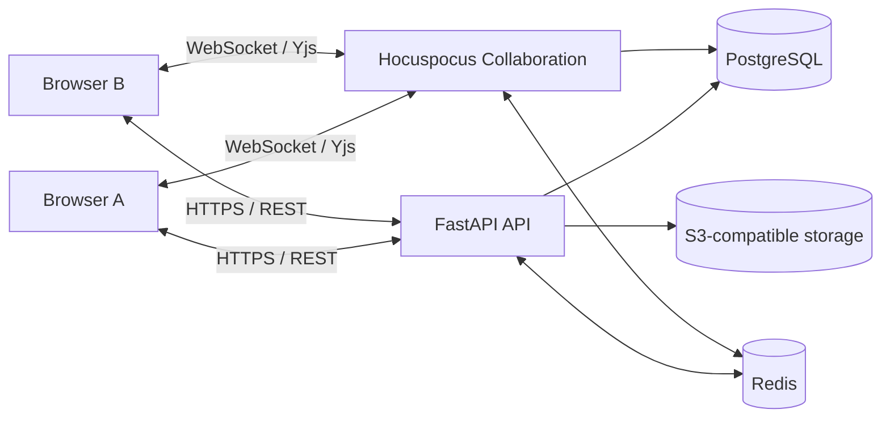
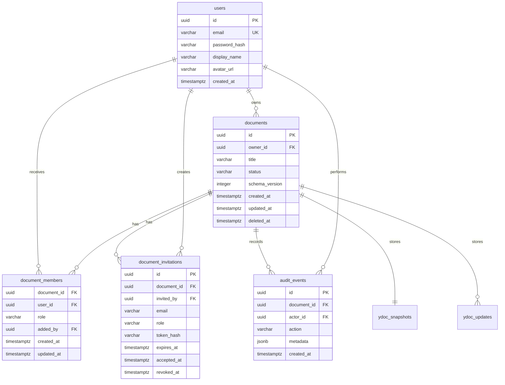
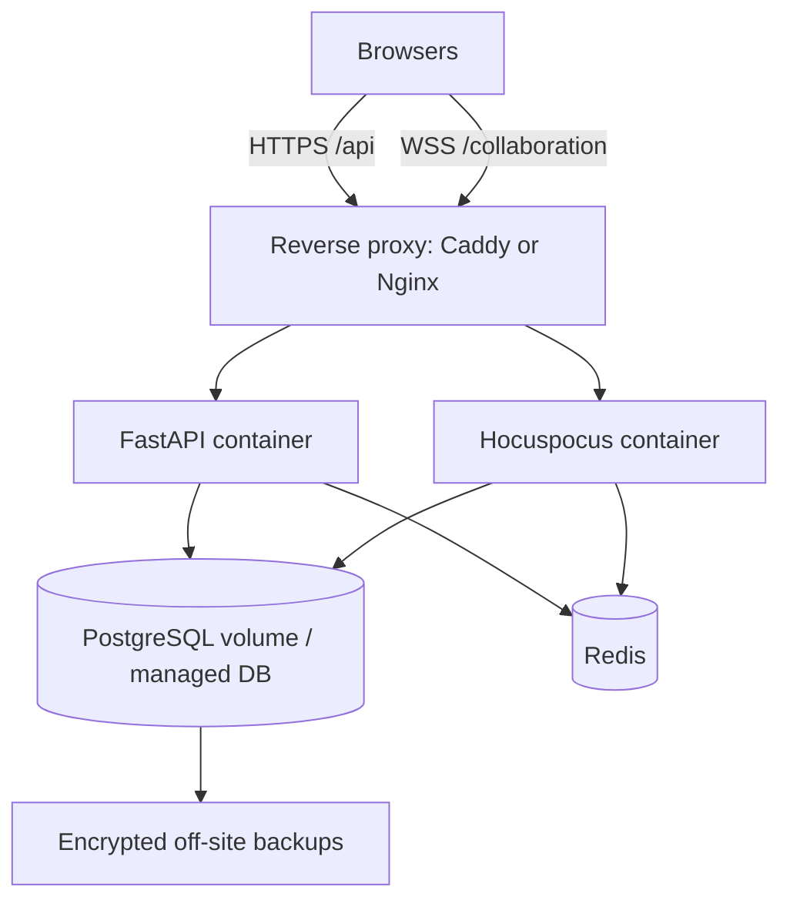

# Technical Architecture
## Real-Time Collaborative Text Editor

- **Working name:** SyncDraft
- **Version:** 1.0
- **Date:** 2026-10-30
- **Status:** Proposed architecture

## 1. Executive decision

Build the editor around a CRDT rather than implementing text synchronization with ordinary REST requests or a last-write-wins database field.

### Recommended stack

| Layer | Technology | Responsibility |
|---|---|---|
| Web frontend | React + TypeScript + Vite | Dashboard, editor shell, sharing UI |
| Rich-text editor | TipTap / ProseMirror | Editing UX and document schema |
| Collaboration model | Yjs | CRDT state, concurrent edits, offline/reconnect merge |
| Collaboration server | Hocuspocus (Node.js) | WebSocket provider/server, awareness, Yjs document lifecycle |
| Main API | FastAPI (Python) | Auth, users, document metadata, memberships, REST APIs |
| Database | PostgreSQL | Users, documents, memberships, invitations, metadata |
| Collaboration persistence | PostgreSQL-backed Yjs update store or supported Hocuspocus database extension | Persist Yjs updates and snapshots |
| Cache / coordination | Redis | Rate limits, ephemeral coordination, optional pub/sub |
| File/object storage | S3-compatible storage (optional MVP) | Avatars and future exports/attachments |
| Deployment | Docker Compose initially; reverse proxy + VPS | Repeatable deployment |

**Important:** FastAPI and Hocuspocus are separate services because the collaboration protocol and Yjs runtime are JavaScript-native. Do not force WebSocket CRDT document handling into FastAPI merely to keep one backend language.

## 2. System context



The frontend uses REST for account, document metadata, sharing, and permissions. It uses a persistent WebSocket connection for document updates and presence.

## 3. Architecture boundaries

### 3.1 FastAPI service owns
- User registration, authentication, and session lifecycle.
- Document metadata and lifecycle.
- Membership and role management.
- Invitation lifecycle.
- Permission decisions exposed to the collaboration service.
- Audit events for security-sensitive actions.
- Health endpoints and API observability.

### 3.2 Hocuspocus service owns
- WebSocket connections for collaborative editing.
- Loading and saving Yjs document state.
- Broadcasting Yjs updates to connected clients.
- Awareness/presence state (cursors, selections, user presence).
- Collaboration-specific rate and payload limits.
- Enforcing authorization before a client joins a document room.

### 3.3 React frontend owns
- Rendering the editor and document navigation.
- Local editing interaction through TipTap.
- Yjs client state and WebSocket connection.
- Presence UI and connection status.
- Calling REST APIs for metadata and sharing.
- Handling optimistic UI without claiming data is durable before server persistence succeeds.

## 4. Collaboration model

### 4.1 Why Yjs / CRDT

A naïve implementation might send `{documentId, fullText}` on every keystroke. Concurrent clients can overwrite each other's edits, and the server must invent conflict-resolution rules.

Yjs represents edits as CRDT operations. Independent concurrent changes can be merged and replicas converge without a central last-write-wins text replacement. The collaboration provider distributes updates; persistence stores enough Yjs state to reconstruct the document.

### 4.2 Rich-text document structure

Use TipTap with a deliberately small schema in MVP:
- paragraph
- heading (levels 1–3)
- bold, italic, underline, strike
- bullet list and ordered list
- list item
- blockquote
- code block
- link
- hard break

Keep the schema versioned. Adding or changing nodes/marks later may require migrations or compatibility handling.

### 4.3 Yjs document shape

Use one Y.Doc per SyncDraft document. TipTap's collaboration extension binds editor content to a shared Y.XmlFragment, for example `prosemirror`.

Conceptual client setup:

```ts
const ydoc = new Y.Doc();
const provider = new HocuspocusProvider({
  url: COLLAB_URL,
  name: documentId,
  document: ydoc,
  token: collaborationToken,
});

const fragment = ydoc.getXmlFragment("prosemirror");
```

The exact package APIs and extension configuration must be pinned to compatible versions during implementation. Do not mix incompatible TipTap, Yjs, and Hocuspocus major versions.

### 4.4 Presence

Use Yjs Awareness for ephemeral state:
- user ID
- display name
- avatar color
- cursor and selection
- optional current activity

Presence is not durable document data. Do not store every cursor movement in PostgreSQL. Awareness data should expire when a connection disappears.

### 4.5 Persistence strategy

Use an append-oriented update model:
1. Receive a Yjs update.
2. Persist the update durably.
3. Broadcast/acknowledge according to the chosen provider's persistence lifecycle.
4. Periodically create a compacted snapshot.
5. Retain updates after the snapshot boundary.

A snapshot must represent a valid Yjs state vector/state update. Compaction must be atomic relative to updates; otherwise an update can be omitted between snapshot creation and log truncation.

**Do not assume that a successful WebSocket send means the update is durable.** The client status should distinguish connected/synchronized from persistence health if the provider integration exposes that information.

### 4.6 Suggested collaboration tables

Two viable designs exist:
- Use the official/supported Hocuspocus database extension and its documented schema.
- Implement a custom persistence adapter with explicit transactions and integration tests.

Do not create a second, competing Yjs persistence implementation alongside the Hocuspocus extension. Select one approach and own its operational behavior.

Conceptual schema if using a custom adapter:

```sql
CREATE TABLE ydoc_snapshots (
  document_id UUID PRIMARY KEY REFERENCES documents(id) ON DELETE CASCADE,
  snapshot BYTEA NOT NULL,
  state_vector BYTEA,
  schema_version INTEGER NOT NULL DEFAULT 1,
  created_at TIMESTAMPTZ NOT NULL DEFAULT now()
);

CREATE TABLE ydoc_updates (
  id BIGSERIAL PRIMARY KEY,
  document_id UUID NOT NULL REFERENCES documents(id) ON DELETE CASCADE,
  update BYTEA NOT NULL,
  created_at TIMESTAMPTZ NOT NULL DEFAULT now()
);

CREATE INDEX idx_ydoc_updates_document_id_id
  ON ydoc_updates(document_id, id);
```

Production implementation must define transaction boundaries, replay order, idempotency, compaction locking, and recovery. Verify that the chosen adapter's format is compatible with the Yjs/Hocuspocus versions deployed.

## 5. Data model

Use UUID primary keys and UTC timestamps. PostgreSQL is the source of truth for users, document metadata, and permissions.

### 5.1 Entity relationship



### 5.2 SQLAlchemy model guidance

- `users.email` must be normalized and unique (case-insensitive uniqueness is recommended).
- `documents.owner_id` references `users.id`.
- `document_members` has a composite unique constraint on `(document_id, user_id)`.
- `document_members.role` is constrained to `editor` or `viewer`; ownership is represented by `documents.owner_id`.
- Invitation tokens are random, high-entropy secrets. Store only a hash; show the raw token only once.
- Use soft deletion for documents if restore is required.
- Add indexes for document listing by owner, membership lookup, and updated time.
- Audit events should not contain passwords, raw invitation tokens, or document contents.

## 6. Authorization model

### 6.1 Permission matrix

| Action | Owner | Editor | Viewer | No access |
|---|---:|---:|---:|---:|
| Read document | Yes | Yes | Yes | No |
| Join collaboration room | Yes | Yes | Yes | No |
| Edit content | Yes | Yes | No | No |
| Rename document | Yes | Optional policy; MVP no | No | No |
| Invite/manage members | Yes | No | No | No |
| Delete document | Yes | No | No | No |

### 6.2 Collaboration authentication

Recommended flow:
1. User authenticates with FastAPI.
2. Frontend requests a short-lived collaboration ticket for a specific document.
3. FastAPI checks membership and role.
4. FastAPI signs a short-lived token containing `sub`, `document_id`, `role`, `exp`, and a unique token ID.
5. Browser connects to Hocuspocus and presents the token using the provider's supported authentication mechanism.
6. Hocuspocus verifies signature, expiry, audience, and document binding.
7. Hocuspocus rejects write-capable connections for viewers or configures server-side read-only enforcement.

The collaboration service must not trust a client-supplied role, user ID, or document ID without validating the signed ticket. A ticket for one document must not authorize another document.

### 6.3 Permission revocation

When a membership is removed or downgraded:
- FastAPI commits the permission change.
- Publish a revocation event through Redis or another reliable coordination channel.
- Collaboration service disconnects affected sessions or marks them read-only.
- Revalidate permission on reconnect and periodically for long-lived sessions.
- Ensure a stale WebSocket cannot continue writing indefinitely.

A signed short-lived ticket alone is not sufficient for immediate revocation unless the collaboration service also receives revocation events or checks current membership.

## 7. REST API design

Base path: `/api/v1`

### Authentication

| Method | Endpoint | Purpose |
|---|---|---|
| POST | `/auth/register` | Create account |
| POST | `/auth/login` | Authenticate |
| POST | `/auth/refresh` | Refresh session/token |
| POST | `/auth/logout` | Revoke current session |
| GET | `/users/me` | Current user profile |

Prefer secure, HttpOnly, SameSite cookies for browser sessions where practical. If bearer tokens are used, define refresh rotation, storage, CSRF/XSS defenses, and revocation explicitly.

### Documents

| Method | Endpoint | Purpose |
|---|---|---|
| GET | `/documents` | List accessible documents |
| POST | `/documents` | Create document |
| GET | `/documents/{document_id}` | Get metadata |
| PATCH | `/documents/{document_id}` | Rename/update metadata |
| DELETE | `/documents/{document_id}` | Soft-delete document |
| POST | `/documents/{document_id}/restore` | Restore soft-deleted document (P1) |

Example create request:

```json
{
  "title": "Project notes"
}
```

Example response:

```json
{
  "id": "2c36a0d4-2c93-4f9a-a1cb-6e43d96f8b80",
  "title": "Project notes",
  "role": "owner",
  "updated_at": "2026-10-30T08:00:00Z"
}
```

### Sharing

| Method | Endpoint | Purpose |
|---|---|---|
| GET | `/documents/{document_id}/members` | List members |
| PUT | `/documents/{document_id}/members/{user_id}` | Add/update member role |
| DELETE | `/documents/{document_id}/members/{user_id}` | Remove member |
| POST | `/documents/{document_id}/invitations` | Create invitation |
| POST | `/invitations/accept` | Accept invitation |

### Collaboration

| Method | Endpoint | Purpose |
|---|---|---|
| POST | `/documents/{document_id}/collaboration-ticket` | Issue short-lived WebSocket ticket |

Example ticket response:

```json
{
  "token": "<short-lived-signed-token>",
  "expires_at": "2026-10-30T08:05:00Z",
  "websocket_url": "wss://collab.example.com"
}
```

### API conventions
- Use Pydantic request/response schemas.
- Return consistent error bodies with stable error codes.
- Use `401` for unauthenticated, `403` for unauthorized, `404` where resource existence should not be disclosed, `409` for state conflicts, and `422` for validation errors.
- Paginate document lists.
- Add request IDs and structured logs.
- Rate-limit authentication, invitation, and ticket endpoints.

## 8. WebSocket protocol and lifecycle

The client connects to the Hocuspocus WebSocket endpoint and joins a room named by the document UUID. Use the collaboration provider's protocol; do not invent a parallel JSON-per-keystroke protocol.

Lifecycle:
1. Fetch document metadata.
2. Fetch collaboration ticket.
3. Create Y.Doc and provider.
4. Join room and exchange Yjs sync state.
5. Receive remote updates and awareness messages.
6. Persist updates through the server adapter.
7. On disconnect, show reconnecting state and allow local edits while the tab remains active.
8. On reconnect, resynchronize and converge.
9. On unmount, destroy provider and Y.Doc resources.

Set limits for maximum message size, connection count per user/IP, room count, and update rate. Validate document IDs and tickets before allocating expensive room resources.

## 9. Frontend architecture

Suggested structure:

```text
frontend/
  src/
    app/
      router/
      providers/
    features/
      auth/
      documents/
      editor/
        components/
        extensions/
        collaboration/
        hooks/
        state/
      sharing/
    components/
      ui/
      layout/
    lib/
      api-client.ts
      auth.ts
      config.ts
    types/
    main.tsx
```

Key components:
- `AppShell`
- `DocumentDashboard`
- `DocumentList`
- `DocumentEditorPage`
- `EditorToolbar`
- `CollaboratorAvatars`
- `ConnectionStatus`
- `ShareDialog`
- `PermissionGate`

Implementation guidance:
- Use TanStack Query (or a similarly consistent server-state library) for REST data.
- Keep Y.Doc/provider lifecycle in a dedicated hook or service, not inside toolbar components.
- Ensure the provider is destroyed on document switch/unmount.
- Keep presence data separate from durable document metadata.
- Use a read-only editor configuration for viewers and enforce read-only on the server too.
- Avoid rerendering the entire editor on every remote awareness update.

## 10. Backend architecture

Suggested repository layout:

```text
backend/
  app/
    api/v1/
      auth.py
      documents.py
      members.py
      invitations.py
      collaboration.py
    core/
      config.py
      security.py
      database.py
      logging.py
    models/
      user.py
      document.py
      document_member.py
      invitation.py
      audit_event.py
    schemas/
    services/
      auth_service.py
      document_service.py
      permission_service.py
      invitation_service.py
      collaboration_ticket_service.py
    repositories/
    main.py
  migrations/
  tests/
```

Hocuspocus service:

```text
collaboration/
  src/
    server.ts
    auth/
      verify-ticket.ts
      permission-check.ts
    persistence/
      database.ts
    hooks/
      on-authenticate.ts
      on-load-document.ts
      on-change.ts
      on-disconnect.ts
    config/
      env.ts
  package.json
  tsconfig.json
```

Use shared token-verification configuration and contract tests between FastAPI and Hocuspocus. Avoid sharing application database models across services; share only stable API/token contracts.

## 11. Deployment architecture

### 11.1 Local development

Docker Compose services:
- `frontend` (Vite dev server)
- `api` (FastAPI)
- `collaboration` (Hocuspocus)
- `postgres`
- `redis`
- optional `minio` for local S3-compatible object storage

### 11.2 Production on a VPS



Requirements:
- TLS termination and WebSocket upgrade support.
- Persistent PostgreSQL volume or managed PostgreSQL.
- Automated encrypted backups with tested restore procedure.
- Secrets supplied through environment/secret manager, not committed.
- Separate internal network for databases.
- Health checks and restart policies.
- Log rotation and disk monitoring.
- Firewall exposing only required ports (typically 80/443 and restricted SSH).

For a single VPS MVP, Docker Compose is reasonable. It is not high availability: the VPS, disk, and database remain failure domains. Do not claim HA until services and storage are deployed redundantly.

### 11.3 Scaling

Scale in this order:
1. Measure one collaboration instance under realistic concurrent-document load.
2. Move PostgreSQL to managed/dedicated storage before the VPS becomes a bottleneck.
3. Add collaboration instances only after defining room routing, shared persistence, and cross-instance awareness/broadcast behavior.
4. Use Redis/pub-sub only where supported and correctly configured by the selected provider architecture.
5. Add load balancing with WebSocket support and sticky routing if required by the collaboration provider.
6. Test failover and reconnect behavior during instance restarts.

Do not assume that adding replicas automatically shares in-memory Yjs documents or awareness state.

## 12. Security checklist

- TLS for all public traffic.
- Secure password hashing and rate-limited login.
- Secure session cookies or carefully managed access/refresh tokens.
- CSRF protection if cookie-authenticated state-changing endpoints are used.
- Strict CORS allowlist.
- Authorization checks on every document API.
- Signed, short-lived, audience-bound collaboration tickets.
- Server-side read-only enforcement for viewers.
- Active-session revocation on membership changes.
- Input validation and payload/message size limits.
- Rate limits by user and IP.
- No raw tokens or document content in logs.
- Dependency scanning and pinned production dependencies.
- Database least-privilege credentials and encrypted backups.
- Security tests for cross-document access and forged roles.

## 13. Observability and operations

Track at minimum:
- Active WebSocket connections and rooms.
- Authentication and authorization failures.
- Collaboration connect/disconnect and reconnect counts.
- Update propagation latency.
- Persistence duration, failures, retries, and backlog.
- Snapshot/compaction duration and failures.
- PostgreSQL connection pool and storage growth.
- API latency and error rate.
- CPU, memory, disk, and network usage.

Use structured logs with request ID, user ID, and document ID where safe. Do not log document body or secrets. Define alerts for persistence failures, database exhaustion, abnormal disconnect spikes, and low disk space.

## 14. Testing strategy

### Unit tests
- Permission matrix.
- Token creation/verification and expiry.
- Document lifecycle and membership services.
- Validation and schema rules.

### Integration tests
- FastAPI + PostgreSQL migrations.
- Collaboration ticket accepted/rejected correctly.
- Unauthorized room join rejected.
- Viewer cannot persist content changes.
- Update persistence and document reconstruction.
- Membership revocation invalidates active sessions.

### Browser / end-to-end tests
- Two independent browser contexts edit one document.
- Concurrent insertions/deletions converge.
- Remote cursors appear and disappear.
- Disconnect, edit locally, reconnect, and verify convergence.
- Refresh and verify persisted content.
- Switch documents and verify old provider is cleaned up.

### Load tests
- Concurrent connections across many rooms.
- Many users in one room.
- Large documents and high update rates.
- Collaboration server restart while clients are connected.
- Database latency and temporary persistence outage.

## 15. Implementation sequence

1. Create monorepo and local Docker Compose.
2. Add PostgreSQL schema and migrations.
3. Implement FastAPI auth and document metadata APIs.
4. Implement membership/permission service and tests.
5. Create Hocuspocus service and signed collaboration-ticket validation.
6. Prove Yjs persistence and reload from PostgreSQL.
7. Build React dashboard and document routes.
8. Integrate TipTap + Yjs + Hocuspocus in the editor.
9. Add presence and connection status.
10. Add sharing UI and permission enforcement.
11. Add revocation, snapshots, backups, observability, and load tests.
12. Deploy staging; execute PRD acceptance criteria before production.

## 16. Architecture decisions to record

| Decision | Current recommendation | Reason |
|---|---|---|
| Conflict resolution | Yjs CRDT | Proven collaborative data model; avoids naïve last-write-wins text replacement. |
| Editor | TipTap / ProseMirror | Extensible structured rich-text editor with Yjs integration. |
| Collaboration service | Hocuspocus | Purpose-built Yjs collaboration server. |
| Main API | FastAPI | Clear REST/auth/business-logic boundary; Python ecosystem. |
| Database | PostgreSQL | Durable relational metadata and supported persistence options. |
| Cache/coordination | Redis | Rate limiting and cross-service coordination where needed. |
| Deployment | Docker Compose on VPS for MVP | Low operational complexity; explicitly not HA. |

## 17. Key implementation caveats

1. Pin compatible major versions of TipTap, Yjs, and Hocuspocus and verify integration against their current documentation before coding.
2. Choose one persistence adapter and test its actual schema and recovery behavior. The SQL shown here is conceptual, not a drop-in replacement for an official adapter schema.
3. Test authorization at the collaboration server, not just in the React UI or FastAPI metadata endpoints.
4. Define the exact meaning of “saved” in the UI. Connected, synchronized, and durably persisted are different states.
5. Treat document schema migrations and snapshot compaction as data-integrity features, not optional cleanup.
6. A single VPS is suitable for an MVP, not a fault-tolerant production platform.
